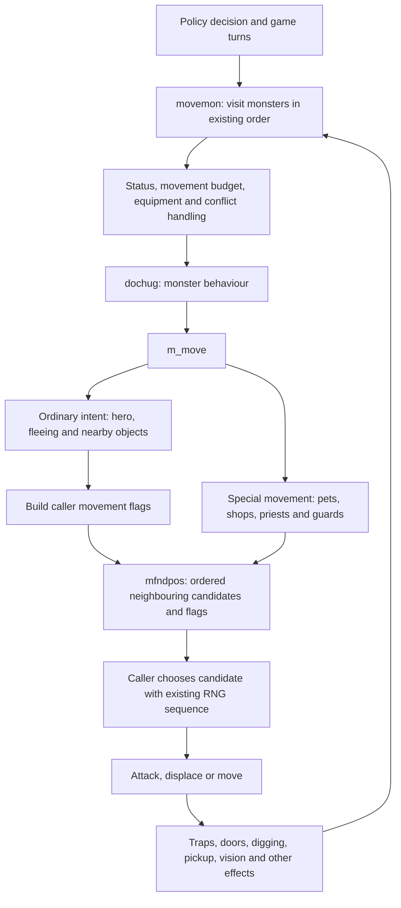
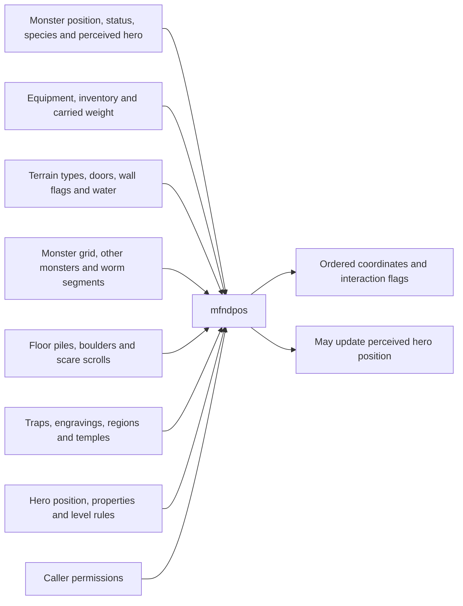
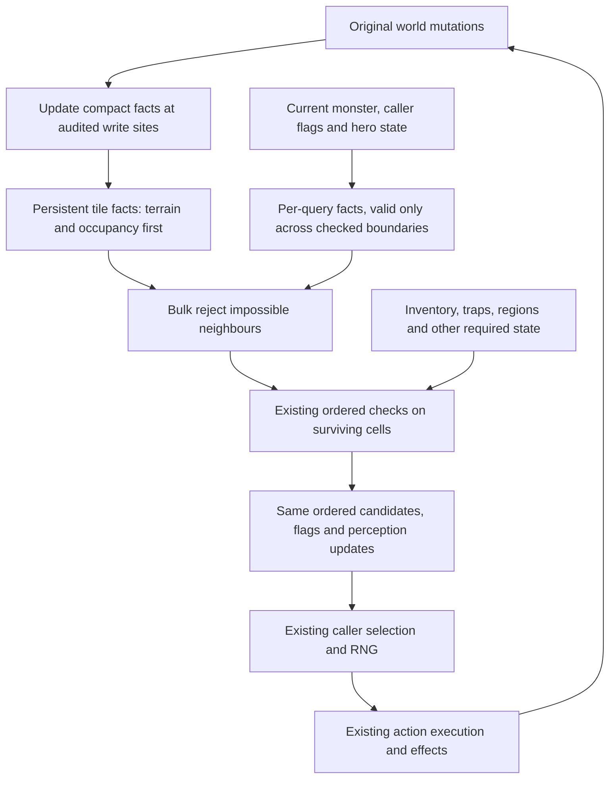

# NetHack movement: current architecture and proposed boundaries

9 October 2026. Design map, not an implemented redesign. No engine changes or new performance measurements in this document.

## The change in perspective

Design the data around the operation: **given this monster, its caller's movement rules and the current world, produce the same ordered neighbouring candidates and their interaction flags**. Then let the existing caller choose and execute the action.

Previously we often made one record smaller or added a cache beside it. That helps only when the hot consumer actually avoids the expensive original accesses. The proposed unit of work is the complete movement query, including the cost of keeping its inputs current.

This does not yet require replacing every monster with arrays, making a second simulator, or changing rollout scheduling. It does require identifying who owns each fact, who reads it, and every event that can change it. Some facts should be maintained when the world changes; others belong only to the current query.

The reference is the isolated retained `monmove_guard_pgo` engine, identified in [RETAINED.json](RETAINED.json), with library SHA256 `2a5cfac52f27a7430383c00e0c2a84ae96cdc12c64c2decbb993aeea8ec2ce84`. It already has compact records, a movement-first monster layout, pools, cached terrain types, a floor-object index and PGO. We are not starting from an untouched engine. The later movement-bitset prototype is a separate candidate, not the retained default.

## 1. Current execution map

The special-movement arrow is not universal: some special actions finish without a neighbour query. The three actual callers of `mfndpos` are ordinary `m_move`, `dog_move`, and `move_special` for priests/shopkeepers. They supply different permissions and make different choices from the result. `m_move` can also be called outside the normal monster loop, such as a leprechaun dodging a player attack.

The candidate result is richer than an eight-bit passability mask. `poss[]` contains ordered coordinates; `info[]` describes hero/monster attacks, displacement, traps, fear, line alignment and other interactions. Later selection uses both the candidate count and order when consuming RNG.

Source anchors:

- [Monster scheduling](engines/monmove_guard_pgo/source/src/mon.c:794), [ordinary movement](engines/monmove_guard_pgo/source/src/monmove.c:877), [neighbour query](engines/monmove_guard_pgo/source/src/mon.c:1366).
- [Pet caller](engines/monmove_guard_pgo/source/src/dogmove.c:974), [priest/shopkeeper caller](engines/monmove_guard_pgo/source/src/priest.c:49), [dodge caller](engines/monmove_guard_pgo/source/src/uhitm.c:450).

### What the neighbour query reads

This is why simply shrinking `struct monst` cannot remove most of the movement working set: many inputs live elsewhere and are shared with other engine systems.

## 2. Ownership and lifetime map

These are proposed boundaries, not new structs that have already been implemented. The first two summaries exist in the isolated bitset candidate. The remaining rows identify design options and missing audits.

| Facts | Current source and consumers | Events that change them | Appropriate lifetime / design |
|---|---|---|---|
| Non-rock terrain | Cached `TYP_AT` plane; early rejection in `mfndpos` | Type setters, full terrain sync, water/air-level updates, restore | Maintain compact bits at the same update points as the existing plane. Implemented in candidate. |
| Occupancy | `level.monsters`; candidate rejection, attacks, worm geometry | Placement/removal, teleport, displacement, worm segments, mounts, clear/restore | Maintain occupancy bits; obtain the actual occupant only when a remaining rule needs it. Implemented in candidate. Preserve worm semantics. |
| Door, wall and drawbridge details | `levl` fields; doors, digging, passwall, diagonal checks, water/lava helpers | Opening, locking, smashing, digging, bridge changes and level generation | Persistent cell facts are possible, but type setters alone do **not** cover these writes. Keep original reads until an exhaustive writer audit and a useful measured budget exist. |
| Species movement traits | `mon->data` and species table; flight, swimming, size, digging and attack traits | Form/species changes; different callers grant different permissions | Separate species facts from instance/caller facts. Many are already cheap macros or per-call locals; another wrapper alone is not an optimization. |
| Equipment-dependent capabilities | Monster inventory, wielded weapon, worn equipment, extrinsics; tools, unlocking, resistance, squeezing and fog passage | Pickup/drop/steal, equip changes, curse changes, item transformations, container contents, form changes | Initially use narrowly scoped per-query values. Persistent summaries need coverage of indirect object mutations, not just inventory-list changes. |
| Position, intent and perception | `mx/my`, `mux/muy`, status, hero properties; movement and fear rules | Movement, displacement, blindness/confusion, hero changes; also `mfndpos` itself | Live mutable state. Never freeze it for the whole monster turn/pass. Maintain the existing order of updates. |
| Floor facts | Object grid and pile chains; garlic, boulders, scare scrolls; floor index for nearby loot | Placement/removal, split/merge, object replacement/type change, level lifecycle | Cell presence/count summaries could replace selected chain walks, but floor-index validity does not automatically cover every fact. Whole floor search still needs item-specific logic. |
| Trap type and location | `ftrap` chain through `t_at`; candidate flags and avoidance | Create/delete, type/location changes, level restore | Optional compact lookup only if its total cost wins. “Harmful to this monster” stays a query: species, resistance and trap knowledge differ. Earlier local trap summaries did not win. |
| Engravings, visible regions, sanctuary | Engraving chain; ordered regions; rooms, priest and hero state | Writing/erasing, region creation/removal/expiry, room/priest/alignment/hero changes | Keep original rules initially. Cache underlying facts only after auditing their owners; do not cache a universal “scary” or “safe” cell. |
| RNG and interaction effects | Caller selection, attacks, traps, region callbacks, pickup and vision | Every applicable game action | Preserve the existing sequential execution. These are behaviour, not reusable query metadata. |

Representative mutation anchors, **not an exhaustive audit** for the unimplemented rows:

- [Type access and setters](engines/monmove_guard_pgo/source/include/hack.h:589), [full terrain sync](engines/monmove_guard_pgo/source/src/vision.c:2929), [monster-grid macros](engines/monmove_guard_pgo/source/include/rm.h:665).
- [Door changes independent of tile type](engines/monmove_guard_pgo/source/src/lock.c:1009), [doors changed during movement](engines/monmove_guard_pgo/source/src/monmove.c:1442).
- [Object placement](engines/monmove_guard_pgo/source/src/mkobj.c:1811), [removal](engines/monmove_guard_pgo/source/src/mkobj.c:1986), [splitting](engines/monmove_guard_pgo/source/src/mkobj.c:494), [replacement](engines/monmove_guard_pgo/source/src/mkobj.c:644), [equipment effects](engines/monmove_guard_pgo/source/src/worn.c:332).
- [Trap creation](engines/monmove_guard_pgo/source/src/trap.c:324), [lookup/deletion](engines/monmove_guard_pgo/source/src/trap.c:5027), [engraving creation](engines/monmove_guard_pgo/source/src/engrave.c:393), [erasure](engines/monmove_guard_pgo/source/src/engrave.c:293).
- [Region creation/removal](engines/monmove_guard_pgo/source/src/region.c:293), [ordered visible-region lookup](engines/monmove_guard_pgo/source/src/region.c:610), [sanctuary dependencies](engines/monmove_guard_pgo/source/src/priest.c:702).

## 3. Proposed architecture

The terrain/occupancy part is already prototyped. The design question is which remaining reads can be eliminated economically. This is **not** a proposal to build a complete copied neighbourhood on every call; doing so could fetch more data than the current short-circuit checks.

For example, an occupied destination which cannot be attacked or displaced can be rejected from a bit. The query then avoids looking up the occupant and evaluating later rules for that cell. If the occupant can matter, it reads the original record and runs the original interaction logic.

Conversely, “monster can squeeze here” is not a tile property. It combines both orthogonal tiles, the monster's body and carried weight, and sometimes fog transformation. A cached tile answer would be wrong; an expensive monster-wide summary might also cost more to maintain than the rare query saves.

The physical representation remains an empirical choice. Bit planes, a compact record or separate arrays should follow the fields actually read together. The earlier 16-byte combined movement tile was flat, so this map is **not evidence for trying the same co-location again**. A full authoritative layout migration is a later option only if remaining readers and write costs justify it.

## 4. Semantic boundaries that must survive

1. **Monsters act sequentially.** Movement, doors, attacks and pickup change what the next monster sees. Do not batch all monsters against one frozen world or reorder monsters for locality.
2. **Caller permissions differ.** Pets and shopkeepers/priests share `mfndpos` but do not share ordinary monster selection logic. Preserve all three caller contracts.
3. **`mfndpos` has a side effect.** Encountering the real hero can update `mux/muy` even if `ALLOW_U` subsequently rejects that cell. A filter cannot drop that visit merely because the final move is forbidden.
4. **Neighbour order matters.** Keep the original x-major/y-major order, output flags and eel retry. Selection depends on count/order and consumes RNG conditionally.
5. **Flag construction is not all pure.** Ordinary movement can call `resist` under Conflict while constructing permissions. Keep that at its original point; do not hoist the entire block into a reusable capability cache.
6. **Callbacks can invalidate assumptions.** Traps, attacks, form changes, regions and pickup can kill, relocate or change the monster and its equipment. Refresh or discard temporary facts across those boundaries.
7. **Facts are not verdicts.** A scare scroll's presence is a cell fact; whether this monster fears it depends on other state. Poison avoidance uses the first applicable visible region, not simply membership of any gas region.
8. **Preserve existing cached-view semantics.** The new non-rock bits follow the cached type plane's updates, not an independent interpretation of raw terrain writes. Level restore and clear must reestablish every derived invariant.

Relevant rules: [fear](engines/monmove_guard_pgo/source/src/monmove.c:137), [inventory-dependent passage](engines/monmove_guard_pgo/source/src/monmove.c:1759), [tight squeezing](engines/monmove_guard_pgo/source/src/hack.c:697), [permissions and selection](engines/monmove_guard_pgo/source/src/monmove.c:1194).

## 5. Measured scope and limits

The [full CPU budget](full_gap_20261009/REPORT.md) for the retained engine at 2,048 instances assigns about **46.86 of 130.70 microseconds per decision (35.9%)** to monster movement and neighbour checks. Its normal-versus-burst difference is **12.78 microseconds** of the total **50.83 microsecond** gap. These are calibrated exclusive profile estimates, not hardware cache-miss attribution.

| Other part of the engine | Normal-versus-burst CPU gap |
|---|---:|
| Player movement / core loop | 6.21 us |
| Observation/interface | 5.09 us |
| Inventory burden | 4.26 us |
| Display / vision | 4.03 us |
| Other monster processing | 3.69 us |
| Floor-object index | 2.58 us |

The linked budget contains the remaining categories. Movement is the largest individual target, but it cannot account for the whole locality problem. Halving its complete measured CPU cost would imply about **22%** overall CPU throughput improvement if everything else stayed fixed; this is a scale-of-opportunity calculation, not a forecast or a training result.

The [movement census](movement_fastpath_census_20261009/REPORT.md) finds about 99 movement entries, 96 neighbour calls and 763 candidate-cell examinations per policy decision in the sampled mature workload. About 40% of cells are rock and 24% occupied, with overlap. Only about 15% of whole calls passed the exploratory simple-neighbourhood classification. That classification was itself insufficient to replace every rule. We therefore cannot assume almost all calls can bypass detailed logic.

The [bitset candidate](engines/movement_masks_pgo/REPORT.md) uses 656 bytes of derived state per game. Matched-window PGO CPU replay gains are **8.19% at 512 games** and **2.53% at 2,048**. It passed 33,554,432 immutable score/depth decision hashes, plus golden/fuzz and comparison checks. It is still isolated, with fresh non-snapshot and full-pipeline confirmation outstanding. Its smaller absolute CPU saving at 2,048 is established; the exact split between maintenance, remaining accesses and other execution effects is not.

The 2,048 tests replicate 512 recorded streams four times. Burst replay has future actions available and is diagnostic; it is not ordinary live rollout collection. None of these figures is a new training-speed claim.

## 6. What earlier attempts tell us

| Attempt | Evidence | Consequence for this design |
|---|---|---|
| Bulk terrain/occupancy rejection | Repeated gain, much smaller at 2,048 | Keep as a useful isolated base; measure the remaining work before expanding it. |
| Combined movement tile | Approximately flat at 512/2,048 | Co-location by itself did not solve the problem. |
| Compact floor metadata | 23% fewer floor-load callbacks, only 0.32% fewer total distinct data lines in source-access traces; native result flat | Removing repeated loads is insufficient when other consumers still fetch the same records. |
| Incremental floor index | 2.93% fewer total distinct lines; about 0.74% provisional native gain at 2,048 | Genuine traffic elimination can still target too little of the total budget. |
| Local trap summaries, movement load/context reuse | Flat or negative screens | Do not repeat them under new names without a new measured reason. |
| Pre-read game state / fixed worker ownership | Lower subsequent step latency; preparation or utilization costs erase the benefit | Include preparation, writes and scheduling in the performance accounting. |

Source-access lines are not measured hardware cache misses. Details: [floor diagnosis](floor_metadata_diagnosis_20261009/REPORT.md), [tile experiment](engines/movement_tile16/REPORT.md), [ledger](ARTIFACTS.json), [continuation log](NEXT.md).

## 7. Next experiment contract

First split the current bitset result at both environment counts into **summary maintenance**, **neighbour queries**, and **the rest of movement/the step**. Use matched states and lightly sampled scopes, checking the result against uninstrumented total time. This establishes whether the smaller 2,048 gain is inside the changed query or elsewhere; it is a bounded measurement, not another general profiling sweep.

Then choose one remaining rule family and write down:

1. The exact original reads/chain walks it would eliminate, their frequency and measured cost.
2. The minimal replacement facts and their owner; every mutation and lifecycle path that must update them.
3. The consumers that must switch to those facts. Count preparation and later reads of the same original records too.
4. The expected cost tradeoff: saved reads across queries versus extra work on mutations and additional memory footprint. If the saving cannot cover maintenance, stop before building a large cache.

For an isolated prototype, compare original/new query outputs, including side effects and ordering; run existing golden/fuzz checks and immutable per-decision replay. Screen ordinary scheduling at 512 and 2,048 with matched compilers and windows. Escalate a repeatable winner to fresh PGO, full score/depth corpora, early-game and non-snapshot checks, then the frozen-policy full training pipeline. Use 8,192 as a scaling check only after the change clears the smaller screens; do not infer its behaviour from resident bytes alone.

The immediate deliverable is evidence that a meaningful piece of the query now needs less data/work **including its update cost**. The longer-term architecture follows from successful boundaries. A cleaner API, fewer lines of C, smaller structs or more caches are not speedups on their own.
