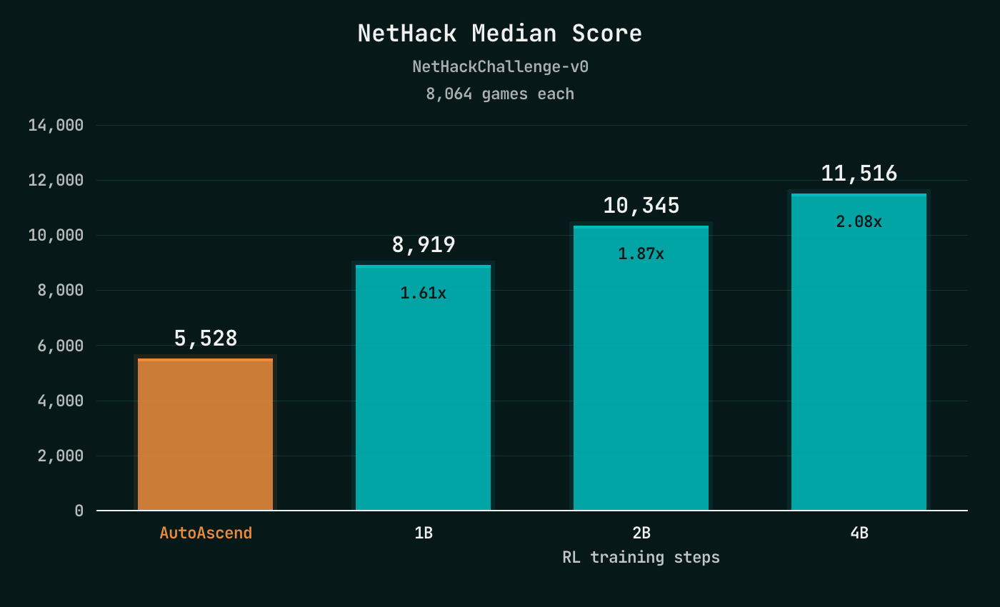
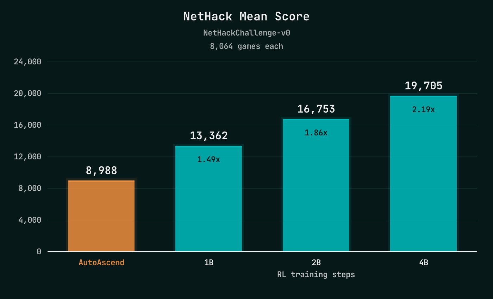
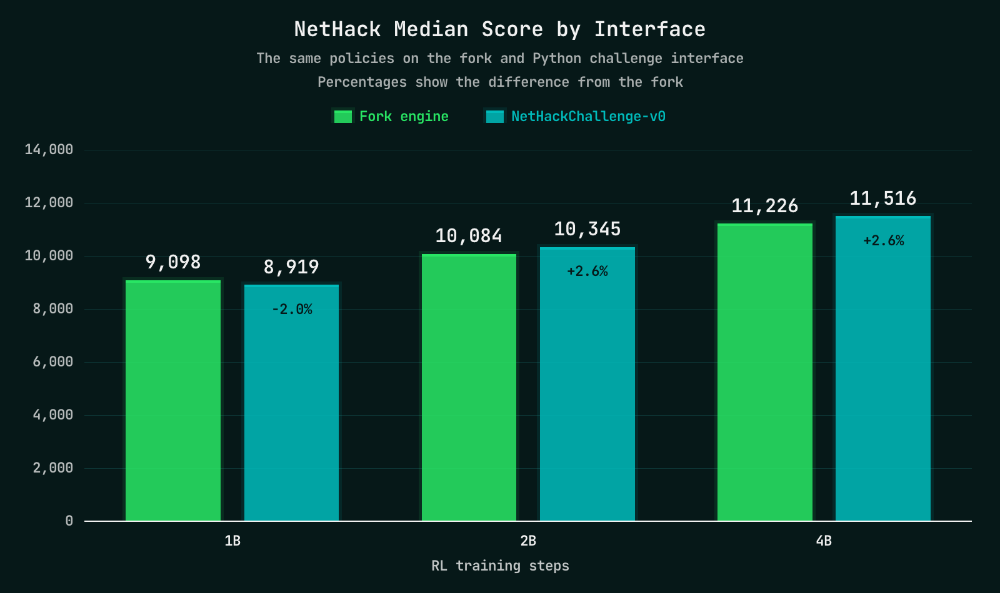
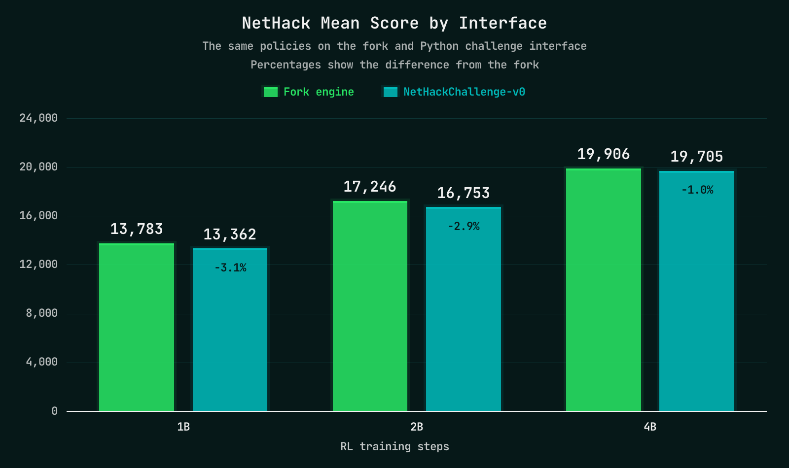
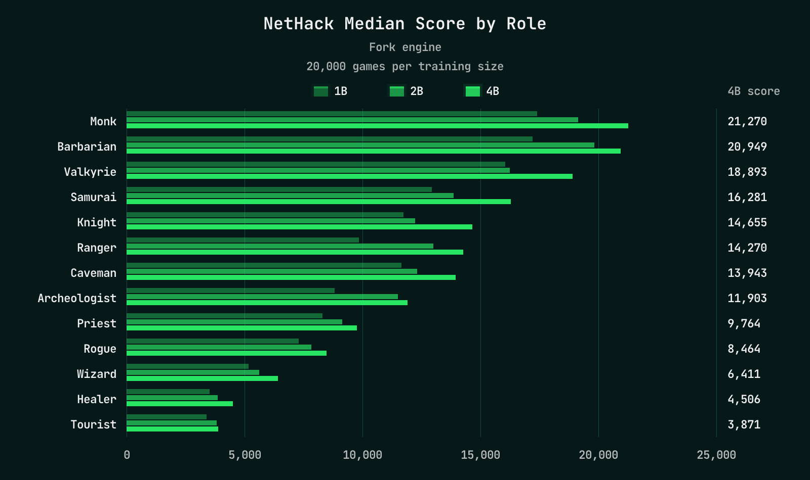
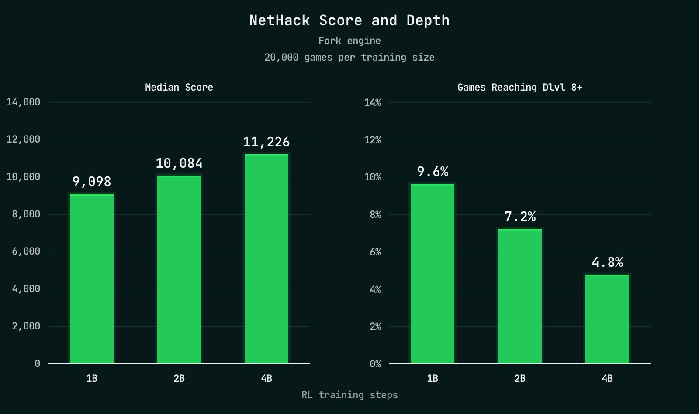

# Beating AutoAscend in NetHack with RL

## Results

On the original Python **NetHackChallenge-v0** environment, our 4B-step agents achieve a **median score of 11,516** and a **mean of 19,705** across 8,064 evaluation games. That is **2.16× AutoAscend's 2021 challenge median** of 5,336.

The same architecture improves with more training: median score rises from **8,919 at 1B steps**, to **10,345 at 2B**, to **11,516 at 4B**. Each doubling of training adds roughly 1,200–1,400 points: approximately linear growth with the logarithm of training steps over this range.

Each training length includes two independently trained policies, evaluated for 4,032 games each. The figures pool their episodes.

Mean score also rises steadily, from **13,362** to **16,753** to **19,705**. AutoAscend's 2023 re-evaluation reported a mean of **8,556**, making our 4B result **2.30× higher**.

These agents train on my optimised fork of NLE, while the headline results above come from the original Python challenge environment. Before using the larger fork evaluations to examine their behaviour, we should check how closely the two agree.

Across all three training lengths, pooled mean and median scores differ by at most about **3.1%**. The following role breakdown uses **20,000 fork-evaluated games per training length**, pooled across the two policies. I'll explain how the faster engine works below.

### Different Characters, Different Results

The challenge randomises the player character, so the overall score combines very different starting conditions. Breaking results down by role shows where the agents are strongest.

Monk, Barbarian and Valkyrie achieve the highest median scores, while Healer and Tourist sit at the other end of the table. Training helps many roles, but the gains are uneven: the overall improvement hides substantial differences in what the policy learns to do with each character.

## Let's Talk Score

What does that improvement look like in the game?

NetHack's score rewards activities such as killing monsters and collecting gold. An agent can become very good at these without getting much closer to winning. My approach is to first learn a competent score-maximising policy, then use that as a starting point for pursuing the game's true objective: **ascension**.

The agents show this distinction clearly. In our fork evaluations, median score increases with training, while the fraction of games reaching dungeon level eight or deeper falls from **9.6% at 1B steps to 4.8% at 4B**.

Higher scores are not translating into deeper runs. The policy is getting better at the objective we gave it, but turning that competence into exploration and eventual ascension is the next challenge.

## Making NetHack Faster

NetHack looks like it should be cheap to simulate. It is a turn-based game displayed as a grid of characters. But running hundreds of games at once exposes costs that barely matter when a human is playing.

I focused on three things: running games in parallel, reducing the cost of the game logic, and avoiding work the agent does not need.

### Parallelism

NetHack stores much of its state in global variables. Stock NLE isolates games using separately loaded copies of the engine library; Python evaluation commonly distributes them across worker processes.

My fork reorganises game state so multiple games can run through a shared engine across a pool of threads. Its C interface also plugs directly into PufferLib's native trainer.

### Less Work per Step

Inside the engine, I reduced repeated work such as terrain lookups and scans through piles of objects. I also removed unnecessary terminal rendering and observation copying from the training path.

The agent needs information that a player could obtain through commands such as farlook or opening a menu. During training, the engine can provide that information directly, saving the repeated commands and text parsing. For stock evaluation, an adapter reconstructs it through the normal observations and actions.

### Measuring the Speedup

With **512 games across eight CPU cores**, a recorded-action benchmark reached roughly **720,000 steps per second** through the fast C engine, compared with **90,000** through Python NetHackChallenge-v0: about **8× faster**. At 1,024 games, the speedup was about **5.4×**.

These are simulation microbenchmarks using short, repeated game trajectories. They exclude policy inference and training, so they are not an end-to-end training speedup. In the actual training runs, reaching four billion steps took approximately **19 hours on one RTX 4090 with CPU workers**.

## Neural NetHacks

Before a policy can learn what to do, it needs a useful representation of what is happening. NetHack makes this unusually interesting: the observation contains a map, character statistics, an inventory, spells and text messages. Each carries different information, and compressing them carelessly can make useful relationships hard to recover.

### Can the Policy See It?

One of my most useful debugging tools was to freeze a trained policy and fit small supervised probes to its internal representations. Could a probe recover the direction of the stairs? Which weapon was equipped? Where the nearest hostile monster was?

These questions helped turn vague observations like “the agent isn't using its bow properly” into specific things to investigate.

But a failed probe has several possible explanations. The encoder might make a feature difficult to represent, the RL objective might never have encouraged it to learn that feature, or the probe itself might be too limited. I needed a way to separate those possibilities.

The next step was to train candidate encoders directly on supervised tasks using recorded game observations. Instead of waiting for another long RL run, I could ask whether an architecture learned basic properties and relationships when given a direct training signal.

Passing these tests did not guarantee a better policy. It did make it much cheaper to reject designs that struggled with information the policy would need.

### Keep the Relationships

The inventory was a particularly useful example. An early design compressed item representations with elementwise max pooling: each output coordinate kept the largest activation across all items.

That can preserve useful facts about what the inventory contains, but it makes questions about a particular item harder. “I have a bow” and “I am currently wielding a bow” are different facts. Combining information across items introduces another problem: “Does this ammunition match the weapon I am holding?”

The lesson was to preserve both individual items and a summary of the collection. In the final encoder, items pass through a shared neural network before sum and max pooling. Equipped items also have a direct route into the policy, so their identity does not have to survive competition with every other object in the inventory.

Monsters and floor items receive their own representations, including their positions relative to the player. The nearest hostile monster and the item underfoot also have direct paths. This makes those particular entities accessible alongside the broader scene summary.

### Different Inputs Need Different Encoders

The final design uses separate branches for the different observation types, but reuses a common entity-encoder architecture for monsters, floor items, inventory and spells: per-entity processing followed by sum and max pooling. The MLP weights are specific to each modality.

A **9×9 local map** preserves nearby spatial structure using broad tile categories. A separate terrain branch summarises landmarks and the surrounding layout. Monster and item representations supply details that the simplified map leaves out.

**Character statistics** include numerical features, condition flags and ratios such as current health divided by maximum health. Learned embeddings identify the character's role, race, gender and alignment.

**Messages** use a lightweight bag of character trigrams: overlapping three-character fragments mapped to learned vectors and summed. This gives the policy a cheap representation of the game's text without requiring a language model.

**Inventory and spells** retain individual entries as well as pooled summaries. All these branches feed into a shared representation and PufferLib's recurrent policy.

The goal was to make useful information easy to combine, while keeping the encoder cheap enough to run billions of times.

### Choosing an Action

The decoder has a related problem. An inventory letter is a temporary label: selecting slot “a” means different things in different games.

Rather than learning a fixed preference for each slot, the policy produces a query for an action such as wearing or throwing. A pointer decoder compares that query with the learned representations of the items currently present and scores each candidate. Spells have a similar selection path.

The action is factored into a verb and the arguments it needs. Throwing requires an item and a direction; wearing requires an item; moving requires a direction. Separate item-selection heads let the policy ask different questions of the same inventory, and only the heads relevant to the chosen verb contribute to its policy loss.

The environment then translates that structured action into NetHack commands and handles the associated prompts.

This gives learning a more useful problem: choose an action, choose the relevant object, and choose a direction where necessary. The policy still has to discover which combinations lead to good play.

<!-- Editorial notes:
This is the consolidated working script, superseding the earlier standalone section drafts.
Score source: certificates/RESULTS.md.
Benchmark sources: benchmark/PYTHON_CHALLENGE.md and benchmark/FAIRNESS.md.
Add primary citations for both AutoAscend baselines before publication.
The log-linear description is a trend across three training lengths, not an established scaling law.
Remaining sections: RL Finds Bugs; What's Next.
Neural NetHacks source: neural_nethacks.md, checked against nethack_encoder_forward and nethack_decoder_forward in ocean/nethack/nethack.cu, plus nethack_policy.cu.
-->
