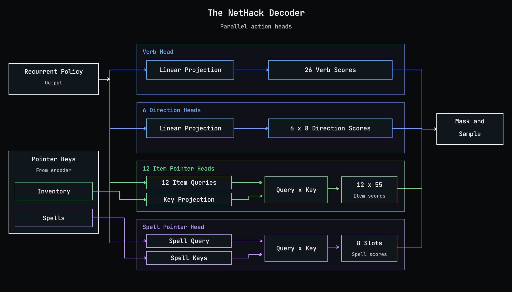

# Decoder diagram

*The recurrent policy produces verb and direction scores, plus a separate item query for each of the 12 item-using verbs. All item queries score the same shared inventory keys. Spells use a separate query and pointer head. Encoder vectors supply the corresponding keys. All heads are computed in parallel; the chosen verb determines which arguments are used.*

Implementation reference: `ocean/nethack/nethack.cu`, `nethack_decoder_forward`, `nh_ptr3_cos_kernel`, and `nh_dec_assemble_kernel`; action layout and argument routing in `ocean/nethack/nethack.h`.

- 26 verb choices.
- Six direction heads (move, run, kick, throw, zap, apply), each with eight choices.
- Twelve item heads (wear, eat, quaff, throw, zap, takeoff, puton, remove, wield, apply, read, drop), each over 55 inventory slots.
- One spell head over eight spell slots.
- Item queries and spell query are linear projections of recurrent hidden state. Inventory keys use a shared linear projection of per-item encoder vectors. Spell keys arrive already projected from the encoder.
- Item pointers use a dot product with query-only normalization and a learned scale per head. Keys are not normalized; this is not cosine similarity despite stale source comments. Spell pointers use a scaled dot product.
- The drawing groups implementation operations for readability. Verb, direction and value projections are implemented together. Action masks constrain the sampled choices; they are not an additional learned decoder layer.

The value head is omitted from this action-decoder diagram.

Rebuild with `bash resources/article/render_decoder.sh`.

The diagram labels the inventory projection output “Shared Item Keys”: one learned projection supplies the same keys to all 12 item-query heads.
