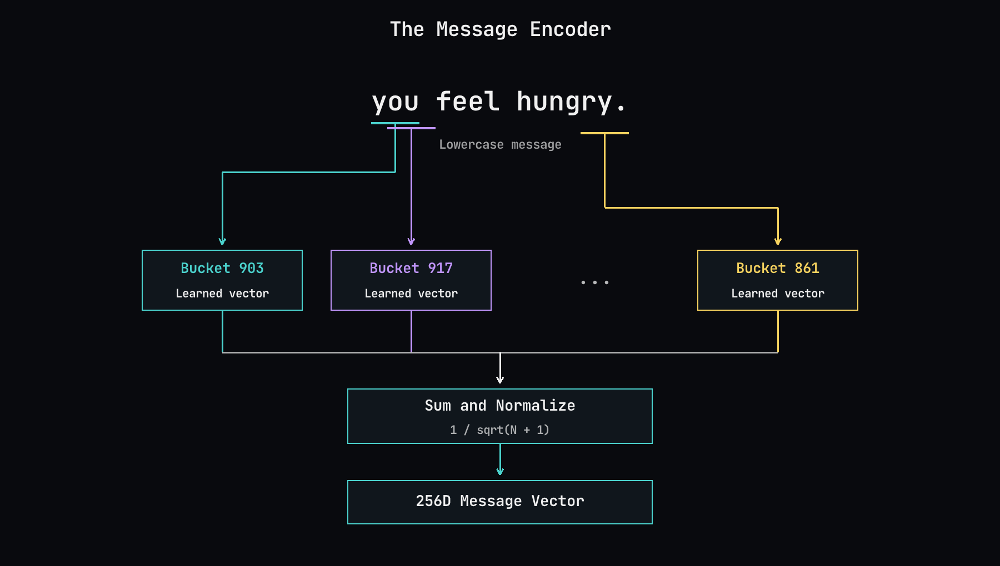

### Reading the Messages

Some of NetHack's most useful feedback arrives as text. Messages tell you why an action failed, announce a change in your condition, or give a clue about an unidentified item. The policy needs to distinguish these events, and it needs to do so billions of times during training.

I use a small message encoder built around hashed character trigrams. A trigram is just three consecutive characters: “you feel hungry.” begins with “you”, “ou ”, and “u f”. Moving this window one character at a time produces overlapping fragments, including spaces and punctuation.

*Overlapping character trigrams map to hash buckets, each with a learned vector. The encoder sums and scales these vectors to produce the message representation. Underlines mark example trigrams; the ellipsis represents the omitted fragments.*

Each fragment passes through a fixed hash function that assigns it to one of 1,024 buckets. Each bucket has a learned 256-dimensional vector, trained alongside the policy. I sum the vectors for all the trigrams, then scale by 1/sqrt(number of trigrams + 1) to moderate the effect of message length. The result joins the other observation branches before the recurrent policy.

This gives related messages a way to share features through their common fragments, without maintaining a word vocabulary. The computation is a set of embedding lookups and a sum. The encoder reads up to 128 message bytes and lowercases letters, while retaining spaces and punctuation.

The tradeoff is that different fragments can collide in the same bucket, and pooling discards their positions in the sentence. Local character order survives inside each trigram, but the encoder does not explicitly represent the full sequence. It is a compact representation of textual cues, rather than a claim that the policy understands the language.
