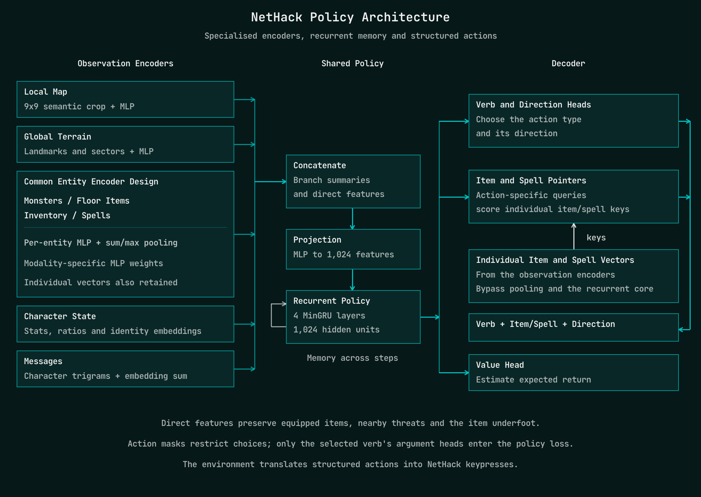

## Neural NetHacks

Before a policy can learn what to do, it needs a useful representation of what is happening. NetHack makes this unusually interesting: the observation contains a map, character statistics, an inventory, spells and text messages. Each carries different information, and compressing them carelessly can make useful relationships hard to recover.

### Can the Policy See It?

One of my most useful debugging tools was to freeze a trained policy and fit small supervised probes to its internal representations. Could a probe recover the direction of the stairs? Which weapon was equipped? Where the nearest hostile monster was?

These questions helped turn vague observations like “the agent isn't using its bow properly” into specific things to investigate.

But a failed probe has several possible explanations. The encoder might make a feature difficult to represent, the RL objective might never have encouraged it to learn that feature, or the probe itself might be too limited. I needed a way to separate those possibilities.

The next step was to train candidate encoders directly on supervised tasks using recorded game observations. Instead of waiting for another long RL run, I could ask whether an architecture learned basic properties and relationships when given a direct training signal.

Passing these tests did not guarantee a better policy. It did make it much cheaper to reject designs that struggled with information the policy would need.

### Keep the Relationships

The inventory was a particularly useful example. An early design compressed item representations with elementwise max pooling: each output coordinate kept the largest activation across all items.

That can preserve useful facts about what the inventory contains, but it makes questions about a particular item harder. “I have a bow” and “I am currently wielding a bow” are different facts. Combining information across items introduces another problem: “Does this ammunition match the weapon I am holding?”

The lesson was to preserve both individual items and a summary of the collection. In the final encoder, items pass through a shared neural network before sum and max pooling. Equipped items also have a direct route into the policy, so their identity does not have to survive competition with every other object in the inventory.

Monsters and floor items receive their own representations, including their positions relative to the player. The nearest hostile monster and the item underfoot also have direct paths. This makes those particular entities accessible alongside the broader scene summary.

### Different Inputs Need Different Encoders

The final design uses separate branches for the different observation types, but reuses a common entity-encoder architecture for monsters, floor items, inventory and spells: per-entity processing followed by sum and max pooling. The MLP weights are specific to each modality.

A **9×9 local map** preserves nearby spatial structure using broad tile categories. A separate terrain branch summarises landmarks and the surrounding layout. Monster and item representations supply details that the simplified map leaves out.

**Character statistics** include numerical features, condition flags and ratios such as current health divided by maximum health. Learned embeddings identify the character's role, race, gender and alignment.

**Messages** use a lightweight bag of character trigrams: overlapping three-character fragments mapped to learned vectors and summed. This gives the policy a cheap representation of the game's text without requiring a language model.

**Inventory and spells** retain individual entries as well as pooled summaries. All these branches feed into a shared representation and PufferLib's recurrent policy.

The goal was to make useful information easy to combine, while keeping the encoder cheap enough to run billions of times.

### Reading the Messages

Some of NetHack's most useful feedback arrives as text. Messages tell you why an action failed, announce a change in your condition, or give a clue about an unidentified item. The policy needs to distinguish these events, and it needs to do so billions of times during training.

I use a small message encoder built around hashed character trigrams. A trigram is just three consecutive characters: “you feel hungry.” begins with “you”, “ou ”, and “u f”. Moving this window one character at a time produces overlapping fragments, including spaces and punctuation.

*Overlapping character trigrams map to hash buckets, each with a learned vector. The encoder sums and scales these vectors to produce the message representation. Underlines mark example trigrams; the ellipsis represents the omitted fragments.*

Each fragment passes through a fixed hash function that assigns it to one of 1,024 buckets. Each bucket has a learned 256-dimensional vector, trained alongside the policy. I sum the vectors for all the trigrams, then scale by 1/sqrt(number of trigrams + 1) to moderate the effect of message length. The result joins the other observation branches before the recurrent policy.

This gives related messages a way to share features through their common fragments, without maintaining a word vocabulary. The computation is a set of embedding lookups and a sum. The encoder reads up to 128 message bytes and lowercases letters, while retaining spaces and punctuation.

The tradeoff is that different fragments can collide in the same bucket, and pooling discards their positions in the sentence. Local character order survives inside each trigram, but the encoder does not explicitly represent the full sequence. It is a compact representation of textual cues, rather than a claim that the policy understands the language.

### Choosing an Action

The decoder has a related problem. An inventory letter is a temporary label: selecting slot “a” means different things in different games.

For each of the 12 item-using verbs, the decoder produces a separate query from the recurrent policy state. All 12 queries score the same shared inventory keys, giving each verb its own distribution over items. Wearing armour and throwing ammunition can therefore select different items from the same inventory. These queries are computed in parallel, before selecting the verb; the chosen verb determines which item selection is used. Verbs without an item argument do not have an item query. Spells have a separate pointer head.

The action is factored into a verb and the arguments it needs. Throwing requires an item and a direction; wearing requires an item; moving requires a direction. Separate item-selection heads let the policy ask different questions of the same inventory, and only the heads relevant to the chosen verb contribute to its policy loss.

The environment then translates that structured action into NetHack commands and handles the associated prompts.

This gives learning a more useful problem: choose an action, choose the relevant object, and choose a direction where necessary. The policy still has to discover which combinations lead to good play.
