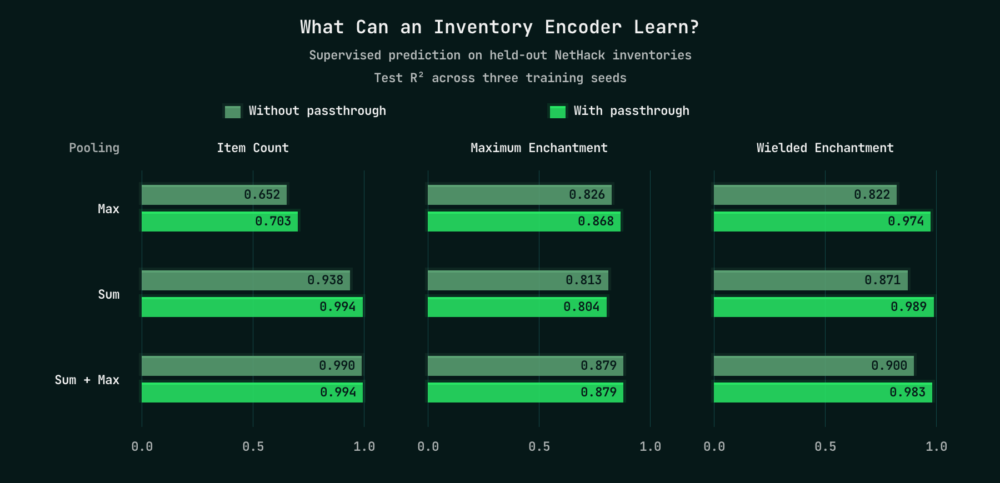

### Testing What an Encoder Can Learn

I wanted a quick way to check whether an encoder could represent the information a good policy would need. Inventory provides a useful example. How many items are we carrying? What is the highest known enchantment? What is the enchantment of the weapon we are currently wielding?

I collected inventory observations from games and trained candidate encoders to predict these properties directly, using a small linear prediction head. Every architecture received the same inputs and supervised targets. I varied how the per-item representations were combined: sum pooling, max pooling, or both. I also tried each with and without passthrough, which retains selected equipped-item representations and state features alongside the pooled summary.

*Prediction quality on held-out games, shown as median R² across three fit seeds. A value of 1 means perfect prediction; 0 is the constant-mean baseline. Unknown enchantments are excluded from the relevant targets. These are three examples from a 16-task benchmark.*

The different operations have different strengths. Max pooling struggles with item count, while summing contributions from every item performs much better. Combining sum and max gives a more balanced representation across these examples. Passthrough makes equipped-item properties much easier to recover: with both pools, prediction of wielded enchantment improves from 0.900 to 0.983 R².

This gave me useful feedback without waiting for another billion-step RL run. It measures how well each architecture learns these tasks with direct supervision. It does not prove an absolute limit on what the architecture can represent, or guarantee that reinforcement learning will discover the same features. The next question is how much of that information can actually be recovered from the trained policy.

<!-- Methods: fixed 4B s705 rollout observations; 65,536 train / 16,384 validation /
16,384 test frames from separate dungeon and action seeds. Six architectures,
three fit seeds, two learning rates selected on validation data, up to 150 epochs.
Full definitions, masking and protocol are in README.md. The maximum-enchantment
comparison is modest; do not describe max-only as decisively beating sum-only.
The count result does not imply max pooling cannot exploit correlated clues. -->
